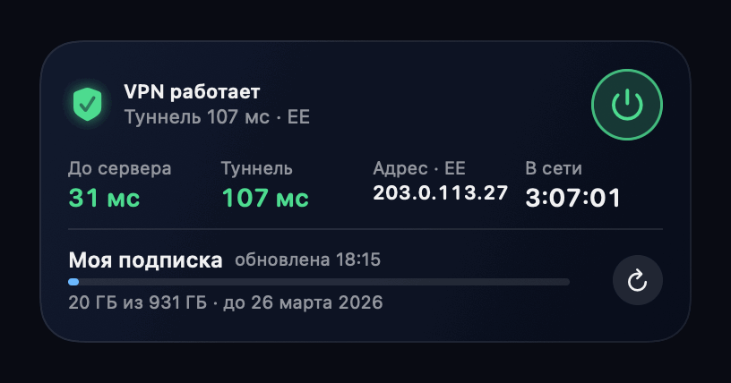
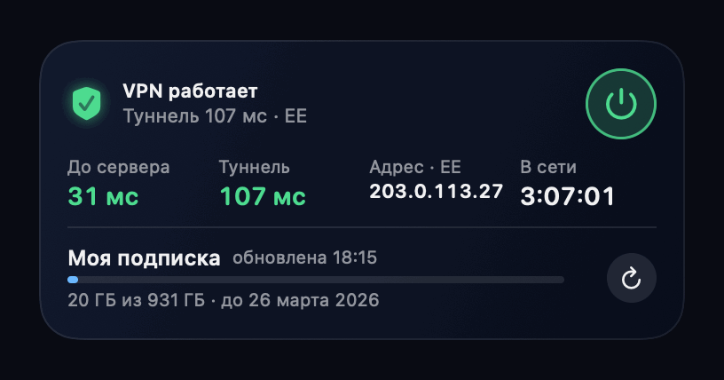

<p align="center"></p>

<h1 align="center">VPNWidget</h1>

<p align="center">
  <b>Виджет для VPN на рабочем столе macOS: статус, пинг, включение кнопкой и тревога, если сменилась страна выхода.</b><br>
  Надстройка над Happ: туннель по-прежнему держит он, а мы показываем, что с ним происходит.
</p>

<p align="center">
  Русский · <a href="README.en.md">English</a>
</p>

<p align="center">
  
  
  
</p>

<p align="center"></p>

---

## Что это

VPN на Маке почти не выключается, а окно клиента при этом занимает кусок экрана. VPNWidget заменяет это окно виджетом: видно,
работает ли туннель, и если нет, то где именно ломается. Сам VPN-клиент не заменяется и не форкается: туннель, серверы и правила
остаются у Happ.

> Неофициальный проект, к разработчикам Happ отношения не имеет. Название приложения упоминается только для того, чтобы было понятно, с чем оно работает.

| Часть | Что делает |
|---|---|
|  **Статус** | Туннель поднят или нет, сколько в сети, внешний адрес и страна, пинг до сервера и время ответа через туннель |
|  **Кнопка питания** | Включает и выключает VPN прямо с рабочего стола, виджет следит за переходом и меняется в тот момент, когда меняется туннель |
|  **Тревога о смене страны** | Если выход в интернет сменил страну (или виден российский адрес), виджет краснеет, приходит уведомление со звуком, и так до тех пор, пока вы не нажмёте «принять» |
|  **Тихий журнал** | Сбои и подключения пишутся в файл вместе с адресом выхода; отчёт показывает, виноват ли конкретный адрес |
|  **Подписка (по желанию)** | Ссылка подписки даёт список серверов, трафик и срок. Без неё виджет работает по серверу, который он находит сам |

Лицензия: [MIT](LICENSE).

---

## Как это работает

1. **Приложение-хозяин** (без значка в Dock, запускается при входе) держит внутри агента: раз в пару секунд читает состояние VPN через `scutil --nc`, права администратора не нужны.
2. **Измерения.** TCP-пинг до сервера привязан к физическому интерфейсу (иначе туннель сам «отвечает» на рукопожатие и показывает пару миллисекунд), время ответа через туннель — HTTPS-запросом к `gstatic.com/generate_204`, страна и адрес выхода — страницей Cloudflare `cdn-cgi/trace` каждые 5 секунд.
3. **Сервер определяется сам:** у расширения туннеля есть открытое соединение с сервером, и его адрес совпадает с внешним, который видят сайты. Ничего не отправляется провайдеру.
4. **Виджет** только рисует то, что записал агент, а кнопки оставляют агенту команду в файле: виджет работает в песочнице и сам VPN не трогает.

---

## Как это выглядит

Анимации нарисованы кодом на вымышленных данных (`scripts/make-gifs.sh`), поэтому в них нет ничего о реальном подключении.

###  Проблема внутри туннеля

Сеть при этом в порядке: сначала туннель тормозит, потом запросы через него перестают проходить, потом сервер не отвечает вовсе. Виджет различает эти случаи и говорит, что делать.

<p align="center"></p>

###  Смена страны выхода

Адрес выхода сменил страну: сервисы увидят другую страну. Виджет остаётся красным, пока вы не нажмёте «Принять».

<p align="center"></p>

Рядом с ним удобно держать большой виджет [NetWatch](https://github.com/burr1t0/NetWatch): он показывает графики и инциденты по всему пути (роутер, провайдер, DNS, VPN), а этот отвечает за сам туннель.

---

## Требования

- macOS 15 или новее.
- Happ с установленным VPN-профилем в системе (виден в `scutil --nc list`). Проверено на Happ 5.7.0 и macOS 26.
- Xcode и [xcodegen](https://github.com/yonaskolb/XcodeGen) для сборки приложения и виджета.
- Сертификат Apple Development (достаточно бесплатного Apple ID).

## Установка

```bash
scripts/install-app.sh    # приложение + виджет → ~/Applications/VPNWidget.app (нужен xcodegen)
```

Для подписи нужен сертификат Apple Development: команда определяется из него автоматически, либо задайте вручную:
`VPNWIDGET_TEAM=ABCDE12345 scripts/install-app.sh`. Идентификаторы бандла (`com.egor.*`) замените на свои в `project.yml`.

Добавить виджет: правый клик по рабочему столу → «Изменить виджеты» → VPN (средний размер). Тап по виджету открывает Happ.
Окно настроек (ссылка подписки, основной сервер) открывается при запуске самого приложения из `~/Applications`.

## Использование

Агент работает внутри приложения, но им можно пользоваться и из терминала:

```bash
swift build -c release
.build/release/vpnd once                    # один проход: статус, пинги, страна выхода
.build/release/vpnd report --hours 72       # тихий журнал: по каким адресам выхода и сколько было сбоев
.build/release/vpnd subscription <ссылка>   # подключить подписку (необязательно)
.build/release/vpnd pin Эстония             # какой сервер считать основным
.build/release/vpnd servers                 # серверы из последней загрузки подписки
```

Данные лежат в `~/Library/Application Support/VPNWidget/` (состояние, настройки, журнал `events.jsonl`).

##  Журнал и отчёт

Всё, что стоит запомнить, пишется в файл тихо: ни уведомлений, ни изменений в виджете. Для каждого сбоя фиксируется время, адрес выхода,
отвечал ли сервер и сколько он длился. Через пару дней отчёт отвечает на вопрос «виноват ли один из адресов, на которые попадает Happ»:

```
По адресам выхода:
  203.0.113.10 (EE): подключений 3, сбоев 4, без трафика 6 мин 12 с
  203.0.113.27 (EE): подключений 5, сбоев 0, без трафика 0 с
```

Первые 20 секунд после подключения не считаются: сразу после включения туннель «прогревается».

##  Что считается проблемой

| Вердикт | Условие |
|---|---|
| Утечка | страна выхода — RU, пока туннель включён |
| Сменилась страна выхода | страна отличается от той, которую вы приняли как обычную (первая увиденная) |
| Сервер не отвечает | туннель поднят, запросы через него не идут, до сервера не достучаться |
| Подключён, но трафика нет | туннель поднят, сервер отвечает, а запросы через туннель нет |
| Нет свежих данных | агент не обновлял состояние больше 45 секунд |

## Структура

- `Sources/VPNCore` — ядро: чтение статуса, пинги, подписка, агент, журнал и отчёт.
- `Sources/VPNUI` — экран виджета, общий для виджета и превью.
- `Sources/vpnd` — консольная утилита.
- `App/` и `Widget/` — приложение-хозяин (агент, уведомления, настройки) и расширение виджета.
- `Tests/` — тесты разбора подписки и статуса, вердиктов, смены страны и отчёта.
- `scripts/` — установка приложения, пересборка анимаций.

Прочее: `swift run vpn-preview build/previews` рисует виджет в PNG без WidgetKit; иконка приложения рисуется кодом
(`swift run vpn-icon App/Assets.xcassets/AppIcon.appiconset`, логотип для README: `swift run vpn-icon --docs docs/icon.png`).

## Ограничения

- Нет собственного туннеля и нет блокировки трафика (kill switch): виджет **замечает** смену страны или утечку и поднимает тревогу, но не отключает сеть. Блокировка требует прав администратора и отдельного сторожа.
- Тревога приходит после смены: часть запросов успевает уйти с новым адресом.
- Работает с VPN-профилем в системе (Network Extension), по умолчанию это Happ (`su.ffg.happ`); другой клиент задаётся в `config.json` (`vpnBundleID`).
- Виджет работает в песочнице и читает и пишет папку агента через временное исключение
  (`com.apple.security.temporary-exception.files.home-relative-path.read-write`). Для App Store такое не подходит, для личной установки — да.
- Кнопка включения вызывает `scutil --nc start/stop`. Проверено на Happ 5.7.0; у другого клиента может не сработать.

## Приватность

Данные хранятся только на вашем Mac. Приложение обращается к `cloudflare.com` (адрес и страна выхода), `gstatic.com` (время ответа через туннель)
и серверу VPN (TCP-пинг), а если вы задали ссылку подписки, то ещё и к ней. Больше никуда. Ссылка подписки хранится в файле настроек
с правами только для вашего пользователя.

> Если у провайдера лимит устройств, учтите: запрос подписки с нового клиента может занять слот. Ссылку подписки задавать необязательно.
